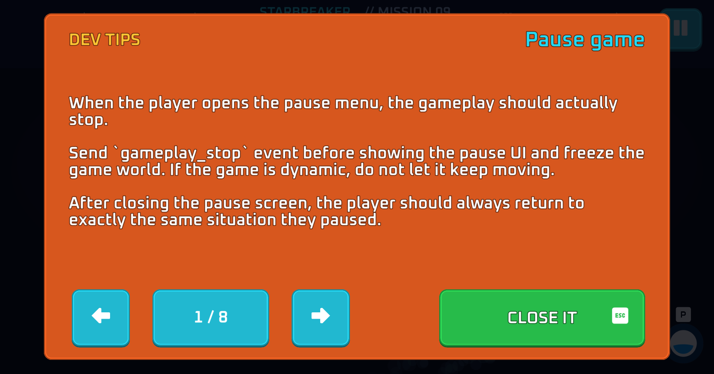
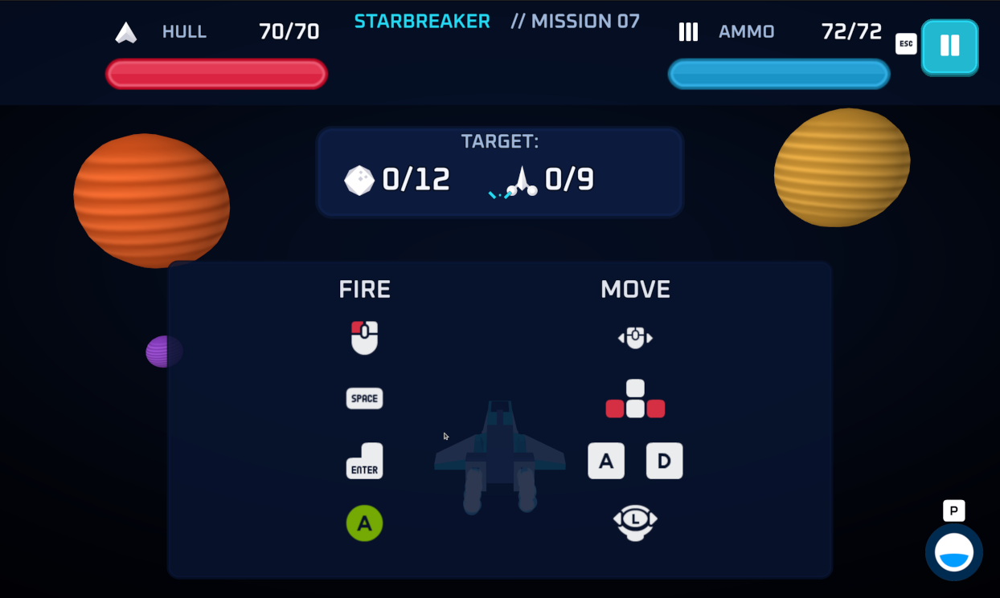
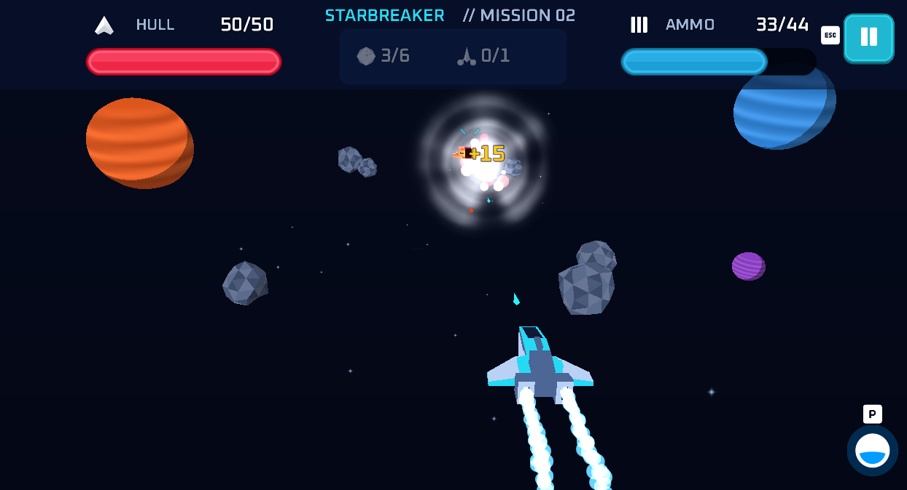
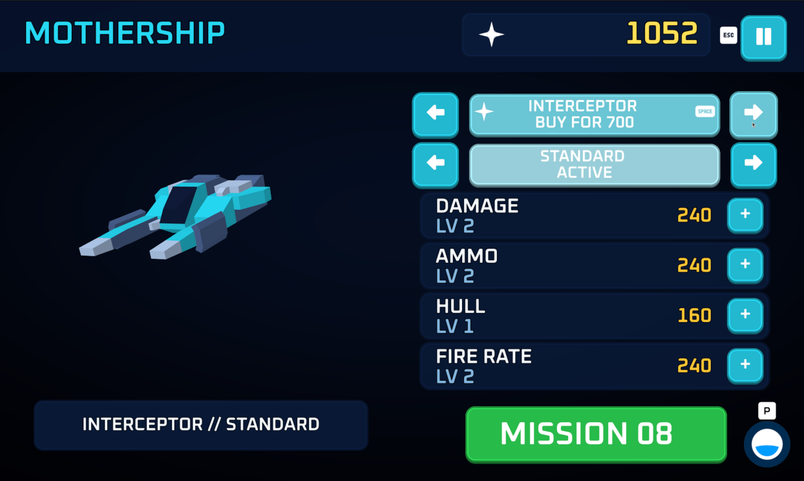
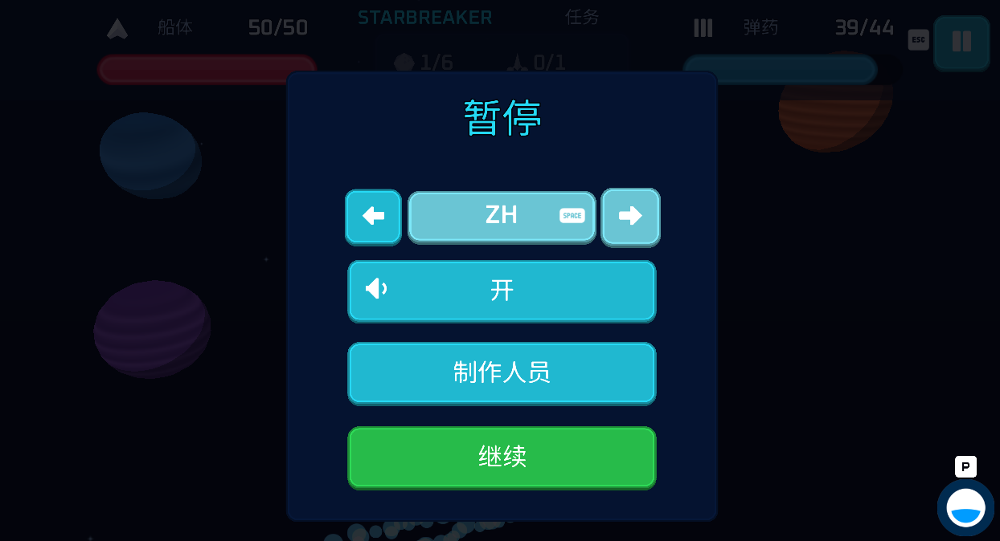

# Defold sample for Poki - 3D space shooter

Starbreaker is a playable Defold sample game built as a starting point and guide for making web games for Poki.

The project contains:

- a complete 3D space shooter game with missions with core gameplay loop, result screens, upgrades shop, pause and settings,
- browser-specific settings and foundations such as Poki SDK, focus handling, audio, saves, touch input, mouse, keyboard and gamepad support, and Live Update setup. You can change the core game and still use the basics of the Poki integration.
- a set of good practices and tips for Poki developers. They describe different aspects of web game development and provide useful knowledge for developers wanting to release a game on Poki and pass the required tests without much friction.

## Run it

Select **<kbd>Project</kbd> → <kbd>Build</kbd>**.

The game will open and show the first Poki Dev Tips selection - switch the tips with arrow buttons or keys. Close the popup with <kbd>Esc</kbd>/<kbd>P</kbd>.
From now on you can open it again in different game contexts using the <kbd>P</kbd> key or by clicking the Poki logo in the bottom-right corner.
Poki Dev Tips are available in each part of the game, including the core gameplay loop, pause screen and shop.



When you close the popup, the game is still in a paused mode, waiting for first input.



### Controls

| Action | Keyboard | Mouse | Gamepad | Touch |
| --- | --- | --- | --- | --- |
| Move | <kbd>A</kbd>/<kbd>D</kbd> or <kbd>Left</kbd>/<kbd>Right</kbd> | Drag horizontally | Left stick | Virtual joystick |
| Fire / confirm | <kbd>Space</kbd> key  | Left button | Bottom button (e.g. Xbox <kbd>A</kbd>) | Fire button |
| Pause / back | <kbd>Esc</kbd> key | - | Upper button (e.g. Xbox <kbd>Y</kbd>) | Pause button |
| Open Poki Dev Tips | <kbd>P</kbd> key | Poki logo | - | Poki logo |
| Preview touch controls on desktop | <kbd>U</kbd> key | - | - | - |



When you reach the objectives of each mission, you see the win (or fail in the other case) screen pop-up.
Gameplay is paused again and you can proceed to the shop screen with upgrades, new ships and skins.



You can always open the Poki Dev Tips for the current context or pause the game using the controls above.

On the pause screen, you can change the language, toggle sound, view the credits or resume the game. Confirm the selected language with <kbd>Space</kbd>, the bottom gamepad button or a click.



## Testing in Poki Inspector

Desktop builds are useful when working on gameplay, but you should also test the game, SDK events and ads in HTML5.

Click **Project → Build Poki HTML5**

Game will be build and opened at [Poki Inspector](https://developers.poki.com/guide/inspector) in the default web browser.

Try Rewarded Ads. Switch tabs during play, and check sound and pause state when returning.
Test touch controls (on desktop you can trigger the touch virtual joystick with the <kbd>U</kbd> key).

## How to read the project

The project has four main parts:

- Game related code, collections, resources, audio catalogs, fonts, etc.
- Shared common services for audio and input.
- Reusable application services e.g. for Poki, ads, context and time control.
- A separate Learn section with Poki developer in-game tips.

The game starts from [app/collections/bootstrap/main.collection](app/collections/bootstrap/main.collection), which is generally a good point to start looking at the project structure.

### Architecture overview

```text
main.collection
├── app/    platform lifecycle, Poki, ads, input, audio and persistence
├── game/   Starbreaker rules, runtime, screen layouts and game-specific GUI
├── ui/     reusable GUI widgets, popup behavior, colors and input helpers
└── learn/  optional in-game Poki development guide
```

The reusable platform layer in `app/` owns application-wide services. The Starbreaker implementation in `game/` attaches itself to that layer through [game/modules/bootstrap/entry.lua](game/modules/bootstrap/entry.lua). Screen layouts, popup collections and GUI scripts live with the game because they implement Starbreaker's mission HUD, mothership, pause and result flows. The shared `ui/` directory contains reusable Druid widgets and helpers used by game screens and Learn. When adapting the sample, replace the game implementation and reuse the platform services and shared UI.

| Path | Responsibility |
| --- | --- |
| [app/](app/) | Reusable app controller, Poki integration, shared context/time services and sample UI sound catalog. Its `main.collection` composes this whole sample. |
| [assets/](assets/) | Art, audio, fonts, atlas and font definitions, models and Particle FX files. |
| [common/](common/) | Shared audio service and client code, input helpers and math utilities used by both app and game. |
| [doc/](doc/) | Images and screenshots for documentation purposes only. |
| [game/](game/) | Game entry, gameplay, screen hosts, GUI layouts and scripts, screen collections, audio, logic, shop, profile and deferred asset configuration. |
| [input/](input/) | Input bindings. |
| [learn/](learn/) | Special separated section with Poki developer tips pop-ups. It can be removed by deleting `learn/` and its one collection instance from `app/collections/bootstrap/main.collection`. |
| [render/](render/) | Rendering pipeline, materials and shaders. |
| [resources/](resources/) | Translations, display profiles, and texture profiles. |
| [ui/](ui/) | Reusable GUI templates (Druid widgets), popup behavior, screen input, focus and shared colors. Game-specific layouts and screen collections live in `game/`. |

### Libraries

There are several external dependencies used - listed in [game.project](game.project).
The choice of used official and community assets is there to simplify the implementation.

| Library | Used for |
| --- | --- |
| [Poki SDK extension](https://github.com/defold/extension-poki-sdk) | Poki lifecycle, device info, and the Poki editor command. |
| [Ads Wrapper](https://github.com/potatojam/defold-ads-wrapper) | Commercial and rewarded ads through its Poki adapter. |
| [Monarch](https://github.com/britzl/monarch) | Loading and switching game screens and pop-ups. |
| [Druid](https://github.com/Insality/druid) | GUI buttons, widgets, menus handling. |
| [Defold Event](https://github.com/Insality/defold-event) | Local gameplay signals for hits, sound, VFX, and HUD updates, also used by Druid. |
| [Lang](https://github.com/Insality/defold-lang) | Translations and language switching. |
| [Saver](https://github.com/Insality/defold-saver) | Game profile, progression and settings (language, sound) saved state. |
| [HTML Loader](https://github.com/potatojam/defold-html-loader) | Custom loading progress display in HTML5 builds. |

## Game flow

```text
Bootstrap → Mission → Result → Shop → Next mission
```

The [game object](game/objects/bootstrap/entry.go) in `app/collections/bootstrap/main.collection` attaches [game/modules/bootstrap/entry.lua](game/modules/bootstrap/entry.lua) to the reusable app controller. `app/collections/bootstrap/main.collection` also lists Starbreaker's screens, sounds, font support and deferred assets.

Those instances are the project's composition point: when you want to use the base with another core game, you can replace the instances there. The app controller and platform services should stay in `app/`.

Poki calls are separated into [poki_service.lua](app/modules/platform/poki_service.lua).

To trace how the code is handling a run, read the following files:

1. [entry.lua](game/modules/bootstrap/entry.lua) attaches the game and reacts to application lifecycle events.
2. [session_flow.lua](game/modules/flow/session_flow.lua) coordinates transitions between missions, results and the shop.
3. [gameplay.script](game/scripts/mission/gameplay.script) owns a running mission.
4. [combat_runtime.lua](game/modules/mission/combat_runtime.lua) updates its actors and combat presentation.
5. [mission_state.lua](game/modules/rules/mission_state.lua) and [combat_rules.lua](game/modules/rules/combat_rules.lua) contain the underlying mission rules.

## Edit the game

Game-specific screens and interface code live in `game/`. Reusable widgets and UI helpers live in `ui/`. Edit [level_config.lua](game/modules/rules/level_config.lua) for predefined missions and [levels.lua](game/modules/rules/levels.lua) for generated missions.
Change [config.lua](game/modules/rules/config.lua) for stats and [progress.lua](game/modules/profile/progress.lua) and [profile.lua](game/modules/rules/profile.lua) for saved progress and purchases.
From there, you can experiment with new actors such as enemy ships and projectiles.

### Changing the visuals

- Edit [render/](render/) to change the render pipeline, materials and shaders.
- Edit [sky.go](game/objects/world/sky.go) and [background.fp](render/background.fp) to change the camera-relative background and its screen-space gradient.
- Edit [world_visuals.lua](game/modules/world/world_visuals.lua) and [planet_variants.lua](game/modules/rules/planet_variants.lua) to change the background planets.
- Replace art in [assets/atlases/](assets/atlases/) and models in [game/resources/models/](game/resources/models/). Use the existing resource paths or update the components that reference them.

### Using this project as a template

- Replace the gameplay-specific code, screen layouts, collections and assets in `game/`. Keep or adapt `ui/` for reusable widgets and helpers.
- Keep or adapt `app/` when you want to retain Poki lifecycle handling, ads, focus, saves, shared input and audio services.
- Keep [main.collection](app/collections/bootstrap/main.collection) as the composition point between the reusable application layer and your game.
- Remove `learn/` and its collection instance from `main.collection` if you do not want the embedded Poki guide.
- Test platform behavior in Poki Inspector after replacing the game, especially first input, focus changes, pause/resume and ad callbacks.

## Optimizations for Web

- **Texture compression and atlas limits:** the UI atlas uses BasisU Medium compression with mipmaps disabled and a 1024 px maximum texture size. The small VFX atlas remains uncompressed to avoid runtime transcoding overhead and uses a 256 px maximum texture size. These settings are defined in [`starbreaker_texture_profiles.texture_profiles`](resources/starbreaker_texture_profiles.texture_profiles).
- **Deferred asset loading:** optional fonts and music are kept out of the initial gameplay payload and loaded through one shared Live Update ZIP. The loader downloads each archive only once, caches and reuses mounted content, retries failed requests, and reports readiness asynchronously.
- **Font and collection reuse:** loaded deferred collections remain resident. Changing language attaches only the required fallback font and prewarms its text instead of rebuilding or reloading every font collection.
- **Screen preloading:** the shop screen is preloaded while the mission result is being finalized, reducing the wait during the return transition.
- **Fixed-step gameplay simulation:** movement, spawning, shooting and combat run in the engine fixed update. Rendering runs at the display update frequency. Gameplay timing is therefore deterministic and independent of rendering frequency.
- **Engine-side animation:** actor and projectile movement, rotation and visual feedback use Defold animations.
- **Event-driven updates:** physics events and gameplay messages drive damage, HUD, audio and VFX reactions.

## License

Project is [MIT licensed](LICENSE). Check the included asset licenses separately in [assets/licenses](assets/licenses).
